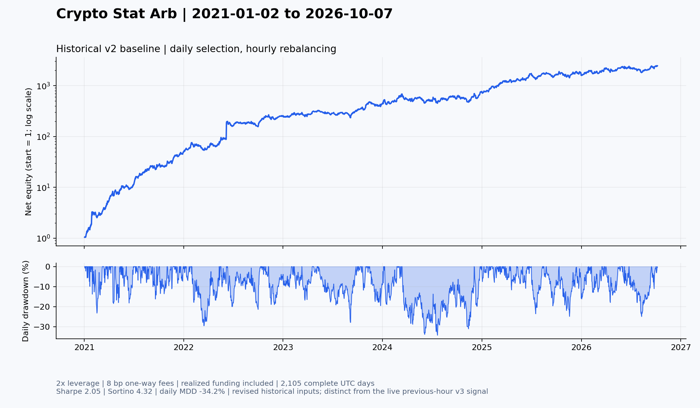

# Crypto Stat Arb

Select-Coin 的必要计算代码：实盘因子和选币流水线、历史回测框架、仓位 Optimizer。包含一张历史回测资金曲线。原始行情、账户信息、订单、密钥、日志与部署配置不在仓库中。

## 目录

| 路径 | 内容 |
| --- | --- |
| `live/data_center/` | 逐笔合并、分位数、分钟/日因子、质量检查、Top50 选币与信号格式 |
| `live/deploy/` | 当前增量计算、日内前缀、日封板与边界发布；保留原脚本名称 |
| `backtest/core/` | 选币、权重聚合、成交/费用/资金费模拟与评价 |
| `backtest/factors/` | 当前历史策略实际使用的 5 个因子文件 |
| `backtest/strategy.json` | 与已核验历史基线一致的三条策略腿及过滤参数 |
| `backtest/research/optimizer/` | Alpha、风险、成本、资金费预测、约束优化、回放及评价 |
| `results/` | 一张历史曲线及其口径、指标和数据文件哈希 |
| `tools/` | 白名单同步、发布检查、曲线生成 |

## 版本与结果口径

| 设置 | 当前实盘计算 | 已有完整历史回测 |
| --- | --- | --- |
| 逐笔金额阈值 | 前一完整 UTC 小时分位数 **v3** | 当小时分位数 **v2** |
| 量能过滤 | 换仓前可用的 599 小时 | 600 小时 |
| 主因子 | 日因子最近 12 个有效观测线性加权 | 同参数的历史 v2 日因子 |
| 小单过滤 | 多头 8 日均值、空头 4 日均值 | 相同窗口设置 |
| 仓位 | 三因子 EWMA14 / 90 天，25% 优化权重混合 | 图中为原始等权基线；Optimizer 另行研究 |

实盘流水线先按单币质量筛选，再在合格池内选币；单币缺失不会阻塞所有合格币。共同市场输入失败或合格池不足 20 个币仍会阻断发布。当前缺失率容忍政策上限为 **10%（含边界）**，并要求对应的交易 ID 区间证据；这不表示数据保证完全无缺失。

以下图为 **v2 原始等权基线**：2021-01-02 至 2026-10-07，共 2,105 个完整 UTC 日，2 倍杠杆、单边 8 bp 成本，计入资金费。每日选币，每小时按原框架再平衡。Sharpe 2.05、Sortino 4.32，日收盘最大回撤 −34.16%。这些是历史模拟结果，不能用于证明 v3 实盘收益或实盘成本。



指标按完整 UTC 日计算，365 天年化；Sortino 的下行偏差分母包含全部交易日。详见 [结果口径](results/backtest_summary.json)。曲线使用修订后的历史数据，非逐日在线数据快照；保留 Unicode 币种名称的历史修复已包含在 `core/data_bridge.py` 中。

## 安装与验证

在 Linux、Python 3.12 上验证。实盘包与回测包各自使用独立导入根目录，请按下面的工作目录运行。

```bash
python3 -m venv .venv
.venv/bin/pip install -r requirements.txt

(cd live && ../.venv/bin/python -m unittest discover -s tests -q)
(cd backtest && X3S_USE_FILE_LOGGING=0 ../.venv/bin/python -m unittest discover -s tests -q)
python3 tools/check_export.py
```

当前验证：30 项实盘计算/接入校验测试、64 项 Optimizer 测试通过。测试使用合成数据，不需要账户或交易权限。只运行实盘计算时可安装 `live/requirements.txt`。

## 运行计算与回测

数据格式、执行顺序和环境变量见 [数据与运行说明](docs/data_and_running.md)。实盘计算模块产生信号文件；交易所账户连接和下单执行不包含在此导出中。

```bash
# 准备好本地数据并设置路径后运行历史基线
cd backtest
../.venv/bin/python backtest.py

# Optimizer 先检查回放能否复现同一份原始回测
../.venv/bin/python tools/run_optimizer_research.py \
  --manifest /path/to/frozen/source_manifest.json \
  --out data/optimizer_research --parity-only
```

Optimizer 默认仅改变既定多空池中的权重，目标包含预期 Alpha、组合方差、交易成本和预期资金费；保留分腿预算与单币权重边界。包含 CMKT/CSMB/CMOM 因子风险模型、Amihud 非流动性/波动率/偏度扩展、EWMA 与 Ledoit–Wolf 收缩实现。相关模块及运行范围见 [Optimizer 说明](docs/optimizer.md)。

2026-10-21 已接入固定三因子 EWMA14 / 90 天日频方案，下一次每日换仓开始使用。币安官网的公开历史市值接口已补齐近期数据。每日策略预算为 `min(1500 USDT, 50% × 账户权益)`，正常多空预算下目标总名义金额至多 3000 USDT。历史 v3 预训练及按月向前验证已实现；本次 99 天验证没有通过 Alpha 发布条件，实盘预期 Alpha 仍为零，并继续积累发布后价格标签。数据、自动运行、执行频率及回退规则见 [实盘 Optimizer 接入](docs/live_optimizer.md)。

## 后续 Git 更新

在原项目旁保留此克隆；同步工具只复制 [白名单](tools/source_allowlist.json) 中的代码，并记录源文件与导出文件的哈希。路径适配和测试样本更新见脚本与 [导出说明](docs/export.md)。源项目新增文件需要先审查，再加入白名单。

```bash
python3 tools/sync_sources.py
git diff --stat
git diff
# 按上面的命令运行两个测试集
python3 tools/check_export.py
git add live backtest docs tools results README.md requirements.txt .gitignore
python3 tools/check_export.py --staged
git commit -m "Update strategy computation and backtest"
git push origin main
```

此流程更新源码版本，不更改生产服务。同步工具不自动提交或推送；历史曲线需用 `tools/plot_backtest.py --equity /path/to/equity_hourly.parquet` 单独更新。

保留源代码内既有的框架作者与版本信息；本仓库没有替第三方框架重新授予开源许可证。
